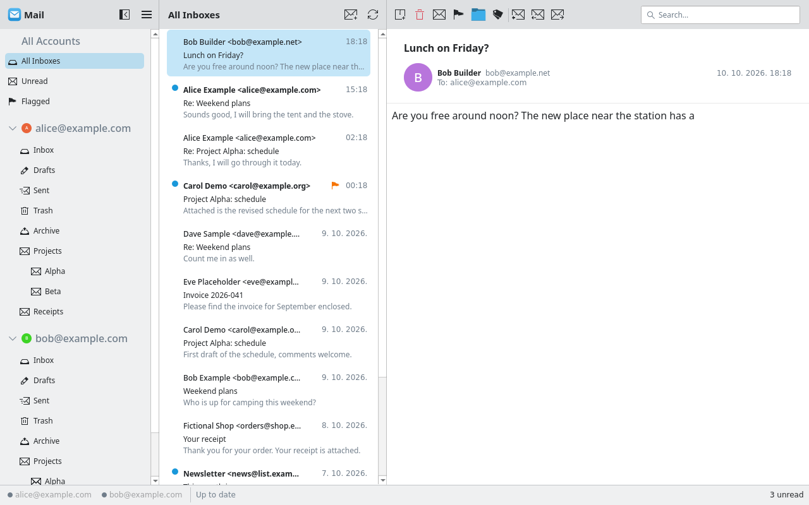
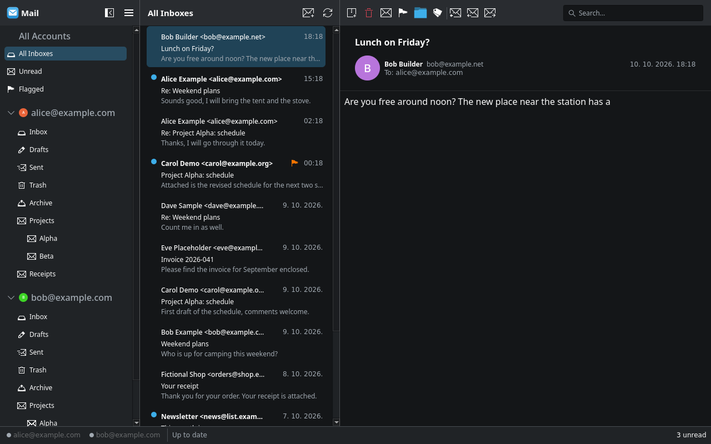

<!--
SPDX-FileCopyrightText: 2026 topke <topke63@gmail.com>
SPDX-License-Identifier: CC0-1.0
-->

# Korrespond

A simple IMAP mail client for KDE Plasma, written in C++20 with Qt 6 and Kirigami.
It is a personal project: it does not use Akonadi, and it talks IMAP/SMTP directly.

The app follows the Plasma colour scheme. Light and dark (demo data):

| Light | Dark |
|---|---|
|  |  |

- **Accounts:** Yahoo (app password), Gmail (Google sign-in, OAuth2) and any other IMAP
  provider with a password. Several accounts at once. Outlook is not available yet.
- **Mail:** folders, conversations, local storage with import date / keep time / size limits,
  IMAP IDLE (push) and new-mail notifications, compose / reply / forward over SMTP.
- **Contacts:** recipient autocomplete and sender names (Google People API for Gmail, addresses
  seen in cached mail otherwise).
- **Safe viewing:** messages are shown without remote content and without JavaScript.

Passwords and tokens are stored in the system keychain (KWallet or Secret Service), never in
the config file.

## Requirements

- A Linux system running Qt 6.6+ and KDE Frameworks 6 (developed on CachyOS with Qt 6.11,
  KF 6.30, KDE Gear 26.08).
- A running KWallet or another Secret Service provider (for QtKeychain).
- A C++20 compiler, CMake 3.22+ and Ninja.

### Packages

**Arch / CachyOS / Manjaro**

```sh
sudo pacman -S --needed base-devel cmake ninja extra-cmake-modules \
    qt6-base qt6-declarative qt6-webengine qt6-networkauth qt6-tools \
    kirigami kirigami-addons qqc2-desktop-style ki18n kcoreaddons kconfig kcolorscheme \
    kmime knotifications knotifyconfig kstatusnotifieritem \
    kimap ksmtp qtkeychain-qt6 libsasl libkgapi
```

`libkgapi` is needed at runtime only: it ships the `libkdexoauth2` SASL plugin that Gmail's
XOAUTH2 login uses. Without it, Gmail sign-in succeeds but the IMAP login fails.

**Other distributions** — install the development packages for these CMake packages:

| CMake package | What it is |
|---|---|
| `ECM` ≥ 6.0 | extra-cmake-modules |
| `Qt6` ≥ 6.6: Core, Gui, Widgets, Network, Sql, Qml, Quick, QuickControls2, WebEngineQuick, NetworkAuth, Test | Qt base, declarative, webengine, networkauth |
| `KF6`: Kirigami, I18n, CoreAddons, Config, ColorScheme, Mime (KMime), Notifications, NotifyConfig, StatusNotifierItem | KDE Frameworks 6 |
| `KF6KirigamiAddons` | kirigami-addons |
| `KPim6IMAP`, `KPim6SMTP` | KIMAP and KSMTP (KDE PIM libraries) |
| `Qt6Keychain` | qtkeychain for Qt 6 |

Runtime: `qqc2-desktop-style`, Cyrus SASL, SQLite (Qt's `QSQLITE` driver), and the
`libkdexoauth2` SASL plugin from libkgapi.

## Build

```sh
git clone https://github.com/topke63/Korrespond.git
cd korrespond
cmake --preset release            # or: cmake -S . -B build -G Ninja -DCMAKE_BUILD_TYPE=RelWithDebInfo
cmake --build --preset release
```

Presets: `dev` (Debug, `build/`), `release` (RelWithDebInfo, `build-release/`),
`asan` (Debug with AddressSanitizer and UBSan, `build-asan/`).

### Run the tests (optional)

```sh
ctest --preset release
```

### Run without installing

```sh
./build-release/bin/korrespond
```

## Install

Per user (no root; make sure `~/.local/bin` is in your `PATH`):

```sh
cmake --install build-release --prefix ~/.local
```

System-wide:

```sh
sudo cmake --install build-release --prefix /usr
```

This installs the `korrespond` binary, the application icon (normal and "unread" variants),
the launcher entry (`io.github.topke63.korrespond.desktop`) and the notification definitions.
Log out and in, or run `kbuildsycoca6`, if the launcher entry does not show up at once.

To update: `git pull`, rebuild and install again.

## Build a package

Install the build and runtime packages from [Requirements](#requirements) first.
Packaging files live in `packaging/`; the AppStream file `data/io.github.topke63.korrespond.metainfo.xml`
is installed by CMake into `share/metainfo`.

### Arch / CachyOS / Manjaro

```sh
cd packaging/arch
makepkg -si          # build and install; use -s alone to only build
```

`makepkg` clones the repository from GitHub, builds with `-DCMAKE_INSTALL_PREFIX=/usr` and
produces `korrespond-git-<version>-x86_64.pkg.tar.zst` in the same folder. Install a built
package later with `sudo pacman -U korrespond-git-*.pkg.tar.zst`.

To package your local, committed checkout instead of the GitHub one, change the `source=` line
in the `PKGBUILD` to `source=("$pkgname::git+file://$(realpath ../..)")`. Uncommitted changes
are not included.

### Any distribution: the three CMake steps

Every package format wraps these commands; only the dependency names and the packaging files
differ. Always use `/usr` as the prefix for a package, never `~/.local`.

```sh
cmake -S . -B build -G Ninja -DCMAKE_BUILD_TYPE=Release -DCMAKE_INSTALL_PREFIX=/usr -DBUILD_TESTING=OFF
cmake --build build
DESTDIR="$PWD/pkgroot" cmake --install build     # the package builder's staging directory
```

### Debian / Ubuntu (`.deb`)

1. Create a `debian/` folder with `control`, `rules`, `changelog`, `copyright` and `compat`.
2. In `rules` use the standard debhelper CMake build: `dh $@ --buildsystem=cmake+ninja`, and set
   `-DBUILD_TESTING=OFF` in `override_dh_auto_configure`.
3. In `control`, list the `-dev` packages for the CMake packages in
   [Requirements](#requirements) under `Build-Depends` (for example `extra-cmake-modules`,
   `qt6-base-dev`, `qt6-declarative-dev`, `qt6-webengine-dev`, `qt6-networkauth-dev`,
   `libkf6kirigami-dev`, `libkf6i18n-dev`, `libkf6mime-dev`, `libkpim6imap-dev`,
   `libkpim6smtp-dev`, `libqt6keychain1-dev`), and the runtime ones, including the
   `libkgapi` SASL plugin, under `Depends`.
4. Build with `dpkg-buildpackage -us -uc -b`, or in a clean chroot with `sbuild`.

### Fedora / openSUSE (`.rpm`)

1. Write `korrespond.spec` using the `%cmake_kf6`, `%cmake_build` and `%cmake_install` macros
   (Fedora) or `%cmake_kf6`, `%kf6_build`, `%kf6_install` (openSUSE).
2. Use `BuildRequires: cmake(KPim6IMAP)` and so on, one line per CMake package in
   [Requirements](#requirements); both distributions resolve `cmake(...)` names.
3. Build with `rpmbuild -ba korrespond.spec`, or in a clean chroot with `mock`.

### Flatpak

Use the `org.kde.Platform` runtime for Qt and KDE Frameworks. Add `kimap`, `ksmtp`, `qtkeychain`
and `libkgapi` as modules in the manifest, and the `io.qt.qtwebengine.BaseApp` base app for
WebEngine. The desktop file is `io.github.topke63.korrespond.desktop` and the AppStream id is
`io.github.topke63.korrespond`; the manifest's `app-id` must match the AppStream id.

### Check the package

```sh
appstreamcli validate data/io.github.topke63.korrespond.metainfo.xml
desktop-file-validate data/io.github.topke63.korrespond.desktop
```

Note for every format: `kimap` and `ksmtp` must be from KDE Gear 26.08 or newer, and the
`libkgapi` SASL plugin (`/usr/lib/sasl2/libkdexoauth2.so`) is a runtime dependency; without it
Gmail sign-in succeeds but the IMAP login fails.

## Upgrading from "Plasma Mail"

Korrespond was called Plasma Mail until version 0.1. On the first start of Korrespond:

- `~/.config/plasmamailrc` is copied to `~/.config/korrespondrc` (the old file stays), and
  `~/.local/share/plasma-mail/` is moved to `~/.local/share/korrespond/`, so accounts, settings
  and the local message cache carry over. Nothing is overwritten if the new names already exist.
- Passwords and tokens in the keychain are found under the old service name `plasma-mail` and
  copied to `korrespond` the first time each one is needed.
- The environment variables `PLASMAMAIL_GOOGLE_CLIENT_ID` and `PLASMAMAIL_GOOGLE_CLIENT_SECRET`
  still work; the other `PLASMAMAIL_*` developer variables are now `KORRESPOND_*`.

An old installation is not removed by installing Korrespond. Delete these by hand:
`~/.local/bin/plasma-mail`, `~/.local/share/applications/plasma-mail.desktop`,
`~/.local/share/icons/hicolor/*/apps/org.topke.plasmamail*` and
`~/.local/share/knotifications6/plasma-mail.notifyrc` (or the same files under `/usr`).

## Set up accounts

Start Korrespond and use **Settings → Accounts → Add Account…** (on first start the setup
page opens by itself). Pick the provider in the list:

| Provider | Login | What you need |
|---|---|---|
| Yahoo | app password | an app password from Yahoo ([below](#yahoo)) |
| Gmail | Google sign-in (OAuth2) | your own Google OAuth client, once ([below](#gmail--google)) |
| Custom IMAP | password | IMAP server and port ([below](#other-providers-custom-imap)) |
| Outlook | — | not available yet (greyed out in the list) |

### Yahoo

Yahoo rejects your normal password over IMAP. Create an app password first:
Yahoo → Account security → turn on 2-step verification → **Generate app password**.
Enter your address and that app password in the app.

### Gmail / Google

Gmail uses Google sign-in, which needs an OAuth client of your own (this repository does not
ship one). You only create it once.

1. Open <https://console.cloud.google.com> and create a project.
2. **Google Auth Platform → Branding / OAuth consent screen:** user type *External*, app name
   "Korrespond". Add your Gmail address as a **test user**, or publish the app "In production"
   (unverified is fine for personal use).
3. **Clients → Create client:** type **Desktop app**. Copy the client ID and secret.
4. Give them to Korrespond, either in `~/.config/korrespondrc`:

   ```ini
   [GoogleOAuth]
   ClientId=…apps.googleusercontent.com
   ClientSecret=…
   ```

   or as environment variables `KORRESPOND_GOOGLE_CLIENT_ID` and
   `KORRESPOND_GOOGLE_CLIENT_SECRET`. Restart Korrespond afterwards.
5. In the app choose **Gmail** and sign in in your browser. The redirect goes to a temporary
   `http://127.0.0.1:<port>/` that only the app listens on.

The client is never committed anywhere; keep the secret out of version control.

Notes:

- Korrespond never sees your Google password; it stores only the OAuth refresh token (in the
  keychain) and requests new access tokens itself.
- The scope is `https://mail.google.com/` (IMAP and SMTP), so the same sign-in covers reading
  and sending.
- A project in "Testing" mode makes Google expire the refresh token after 7 days. If the app
  asks you to sign in again every week, publish the app "In production" (it stays unverified,
  which is fine for personal use; Google shows a warning screen you click through).
- One OAuth client works for any number of Gmail addresses; add each one as a test user while
  the app is in "Testing". Google Workspace addresses work the same way if the admin allows
  the client.

#### Gmail contacts (optional)

For recipient autocomplete from your Google contacts:

1. In the same Google Cloud project, enable the **People API**.
2. Add the scopes `https://www.googleapis.com/auth/contacts.readonly` and
   `https://www.googleapis.com/auth/contacts.other.readonly` to the OAuth consent screen
   (in "Testing" mode the account must be a test user).
3. In **Settings → Contacts**, click **Allow Access to Contacts…** for the account
   (existing tokens do not carry the new scopes).

### Other providers (custom IMAP)

Any provider that offers IMAP with a password works through **Custom IMAP**: fastmail.com,
iCloud, GMX, mailbox.org, posteo.de, your own server, and so on.

1. Choose **Custom IMAP**, enter your email address, your name and the password.
2. Fill in **IMAP server** (for example `imap.example.com`) and **Port**. Port `993` uses TLS
   from the first byte; port `143` upgrades with STARTTLS. Connections are always encrypted.
3. Click **Connect**. The login is checked before the account is saved.

Many providers want an **app password** instead of your normal password when 2-step
verification is on (iCloud, Fastmail, GMX with 2FA, and others); create one in the provider's
account settings and use it here.

**Sending mail with a custom account:** fill in **Outgoing server (SMTP)** and **SMTP port**
on the same page (for example `smtp.example.com`, `465`). Port `465` uses TLS from the first
byte; any other port (for example `587`) uses STARTTLS. The password is the same one as for
IMAP. If you leave the outgoing server empty, the account can only read mail.

Typical servers:

| Provider | IMAP | SMTP |
|---|---|---|
| Yahoo (built in) | `imap.mail.yahoo.com` 993 | `smtp.mail.yahoo.com` 465 |
| Gmail (built in) | `imap.gmail.com` 993 | `smtp.gmail.com` 465 |
| iCloud | `imap.mail.me.com` 993 | `smtp.mail.me.com` 587 |
| Fastmail | `imap.fastmail.com` 993 | `smtp.fastmail.com` 465 |
| GMX | `imap.gmx.net` 993 | `mail.gmx.net` 587 |
| mailbox.org | `imap.mailbox.org` 993 | `smtp.mailbox.org` 465 |

(Check the provider's own help page; these are the usual values, not something Korrespond
verifies.)

**Not supported:** Outlook.com / Microsoft 365 (they have switched off password login and
need OAuth2, which is planned), and providers that only offer OAuth2.

## Files

| Path | Contents |
|---|---|
| `~/.config/korrespondrc` | accounts (no passwords), storage settings, `[GoogleOAuth]` client |
| system keychain | app passwords and OAuth tokens |
| `~/.local/share/korrespond/` | local message cache |

## Troubleshooting

- **"No Google OAuth client is set up"** — step 4 of the Gmail setup is missing; restart the app
  after editing `korrespondrc`.
- **Gmail signs in but cannot log in to IMAP** — the `libkdexoauth2` SASL plugin is missing
  (`/usr/lib/sasl2/libkdexoauth2.so`; package `libkgapi` on Arch).
- **Yahoo says the password is wrong** — you need an app password, not your web login password.
- **CMake cannot find `KPim6IMAP` / `KPim6SMTP`** — install KIMAP and KSMTP development
  packages from KDE Gear 26.08 or newer.

## Development

- Source layout: `src/engine` (no UI), `src/models`, `src/app` (application), `src/qml` (UI),
  `autotests`, `tools` (`imap-probe`, manual IMAP checks; not installed).
- QML lint: `cmake --build --preset dev --target all_qmllint`.
- Formatting: `cmake --build build --target clang-format`; a pre-commit hook checks changed lines.
- The task list and design notes are in [`PLAN.md`](PLAN.md).

## License

Korrespond is free software, licensed under the GNU General Public License, version 3
or (at your option) any later version: GPL-3.0-or-later. See [`LICENSES/GPL-3.0-or-later.txt`](LICENSES/GPL-3.0-or-later.txt).
